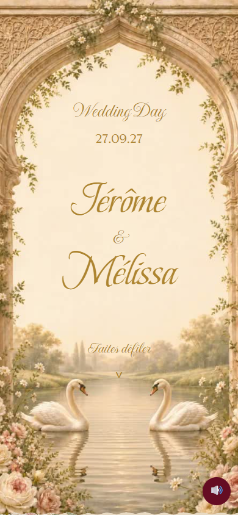
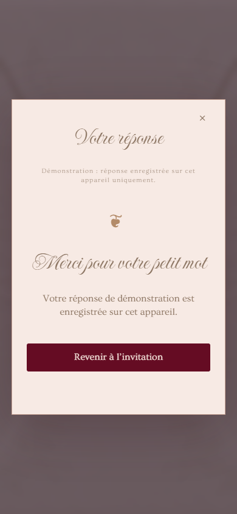

# Invitation de mariage — template configurable

Reconstruction locale de `https://invitation-jerome-melissa.vercel.app/`, **pixel-identique** à l'original (1 589 100 pixels comparés, 0 écart), et **personnalisable depuis un seul fichier**.



---

## Lancer le site

```bash
python -m http.server 8123
# → http://127.0.0.1:8123/
```

Un serveur HTTP est nécessaire : le `file://` bloque `fetch('config.json')` (le repli `js/config-inline.js` prend le relais, mais il faut le régénérer après chaque modification de la configuration).

---

## Personnaliser : un seul fichier

**`config.json`** contient toutes les données de l'invitation. Le HTML, le CSS et le JS ne contiennent plus aucune donnée en dur : ils lisent le fichier au chargement.

| Section de `config.json` | Contenu |
|---|---|
| `meta` | titre de l'onglet, couleur de la barre mobile |
| `couple` | prénoms, séparateur, signature, libellés d'accessibilité |
| `event` | date ISO, date affichée, cible du compte à rebours (avec fuseau), libellés du compteur |
| `hero` | surtitre, indication de scroll, textes d'accessibilité |
| `opening` | libellés de l'ouverture, durées du fondu, message d'attente |
| `intro` | poème (liste de lignes), greeting, paragraphe d'accueil |
| `program` | titre + liste des étapes (`time`, `label`) |
| `venue` | nom du lieu, ornement, accroche, lien Google Maps |
| `details` | titres et textes (tenue, cadeau) |
| `attendance` | section RSVP, signature, texte alternatif de la photo |
| `dialog` | libellés du formulaire, clé de `localStorage`, message d'erreur |
| `footer` | mention, libellé du bouton « Revoir l'ouverture » |
| `sound` | icônes, libellés ARIA, volume |
| `assets` | chemins de tous les médias et des polices |

### Exemple

```jsonc
{
  "couple": {
    "partnerOne": "Awa",
    "partnerTwo": "Moussa",
    "signature": "Awa & Moussa"
  },
  "event": {
    "dateISO": "2028-06-14",
    "dateDisplay": "14.06.28",
    "countdownTarget": "2028-06-14T16:00:00+01:00"
  },
  "program": {
    "title": "Déroulé de la fête",
    "events": [
      { "time": "18 h", "label": "Accueil" },
      { "time": "20 h", "label": "Dîner" },
      { "time": "23 h", "label": "Bal" }
    ]
  },
  "venue": {
    "name": "Le Château des Palmiers",
    "mapsUrl": "https://www.google.com/maps/search/Chateau+des+Palmiers+Dakar"
  }
}
```

Rechargez la page : tout suit. Aucun HTML, CSS ou JS à toucher.



### Remplacer les médias

Déposez vos fichiers dans `assets/` et pointez les chemins dans `config.json → assets` :

```jsonc
"assets": {
  "openingVideo": "assets/mon-enveloppe.mp4",
  "interiorVideo": "assets/mon-hero.mp4",
  "music": "assets/ma-musique.mp3",
  "couplePhoto": "assets/nous.jpg"
}
```

Les visuels utilisés par le CSS (`garden.png`, `paper-grain.svg`, `envelope-realistic.png`, `floral-corner.png`) passent par des variables `--asset-*` automatiquement redéfinies depuis la même section.

### Polices

```jsonc
"assets": {
  "fonts": {
    "BeauRivage":    { "src": "assets/fonts/beau-rivage.woff",  "format": "woff" },
    "ImperialScript":{ "src": "assets/fonts/imperial-script.woff","format": "woff" },
    "Ovo":           { "src": "assets/fonts/ovo.woff2",          "format": "woff2" }
  }
}
```

Les déclarations `@font-face` sont régénérées à l'exécution ; `css/style.css` ne garde que les valeurs par défaut.

---

## Structure

```
invitation-mariage/
├── index.html              structure sémantique + liaisons data-cfg
├── config.json             SOURCE UNIQUE des données
├── css/style.css           1 746 lignes — cascade d'origine vérifiée
├── js/app.js               logique applicative (24 ko, commentée)
├── js/config-inline.js     repli file:// (généré)
├── assets/                 14 médias + fonts/ (3 polices)
├── source/                 extraits bruts du site d'origine (voir source/README.md)
├── tools/                  scripts de régénération
├── docs/
│   ├── RE-RAPPORT.md       rapport complet de rétro-ingénierie
│   └── previews/           captures d'écran
└── .gitignore
```

Le HTML déclare ses liaisons :

| Attribut | Effet |
|---|---|
| `data-cfg="chemin"` | `textContent` |
| `data-cfg-html="chemin"` | `innerHTML` (tableaux → lignes séparées par `<br>`) |
| `data-cfg-attr="attr:chemin"` | `setAttribute` |
| `data-cfg-list="chemin"` | reconstruit une liste d'éléments |

---

## Scripts

```bash
python tools/inline_config.py   # régénère le repli file:// depuis config.json
python tools/build_css.py       # régénère css/style.css depuis source/pretty.css
```

`build_css.py` **échoue** si le CSS régénéré diffère de la source — la cascade CSS d'origine est donc garantie intègre.

---

## Notes techniques

- **Zéro dépendance** : pas de framework, pas de CDN, pas de police distante.
- **Compte à rebours** : cible `event.countdownTarget` (ISO 8601 avec fuseau), rafraîchi chaque seconde.
- **Audio** : la musique démarre dans le gestionnaire du clic sur l'enveloppe — seul moyen de contourner la politique d'autoplay des navigateurs.
- **RSVP** : stocké en `localStorage` sous `dialog.storageKey`. Format : `{"name":"…","attendance":"yes","guests":"1","song":"…","message":"…"}` (toutes valeurs en chaînes).
- **Accessibilité** : `<main inert>` tant que l'enveloppe n'est pas ouverte, `aria-current="step"` sur l'étape de programme courante, `aria-pressed` sur le bouton de son, focus visible sur tous les contrôles.
- **Réduction de mouvement** : `prefers-reduced-motion: reduce` court-circuite la vidéo et ouvre l'invitation directement.

---

## Rétro-ingénierie

Le détail complet de l'analyse (extraction des assets, machine à états, moteur de rendu, comparaisons pixel) est dans **[docs/RE-RAPPORT.md](docs/RE-RAPPORT.md)**.

---

## Crédits

Les médias de `assets/` proviennent de la page d'origine (`https://invitation-jerome-melissa.vercel.app/`, invitation de démonstration) et sont utilisés ici à des fins de reproduction technique. Remplacez-les par vos propres visuels pour tout usage réel.
